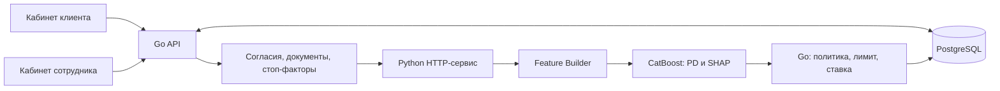

# Альфа · Умный кредитный кабинет предпринимателя

Хакатонный прототип кредитного конвейера для действующих клиентов-предпринимателей. Решение связывает кабинет клиента, автоматические проверки, модель кредитного риска и работу сотрудника банка: от подачи заявки до моделируемой выдачи.

**Онлайн-демо:** [alfahack-demo.onrender.com](https://alfahack-demo.onrender.com). Логин общего входа — `demo`, пароль команда передаёт отдельно. После входа можно выбрать тестовую компанию или кабинет сотрудника.

Все компании, финансовые сведения и кредитные истории синтетические. Документы демонстрационные, подписание и выдача условные; реальные денежные операции не выполняются.

## Идея решения

Для предпринимателя важен понятный путь к финансированию: заполнить заявку, увидеть этап рассмотрения, предоставить недостающие сведения и получить условия или объяснение отказа. Для банка — автоматизировать типовые проверки, выделить случаи для сотрудника и сохранить основания решений.

В MVP два продукта:

| Продукт | Сумма | Срок | Особенности |
| --- | --- | --- | --- |
| EXPRESS | 300 тыс. — 5 млн ₽ | 6–36 месяцев | Текущие потребности бизнеса |
| EQUIPMENT | 500 тыс. — 15 млн ₽ | 12–60 месяцев | Стоимость оборудования, документ поставщика, ручное рассмотрение |

Ключевые идеи:

- **Сквозной процесс.** Одобрение — промежуточный этап: клиент принимает условия, условно подписывает договор и получает статус выдачи.
- **Разделение прогноза и решения.** CatBoost оценивает риск; Go применяет стоп-факторы, рассчитывает лимит и ставку, определяет маршрут заявки.
- **Осмысленная ручная проверка.** Сотрудник может одобрить, выдвинуть контрпредложение, отказать или запросить данные. Изменение рекомендации модели требует комментария и фиксируется в аудите. Ограничения по продукту и платёжной ёмкости сохраняются.
- **Проверяемые основания.** Сохраняются снимок источников, признаки, ответ модели и история переходов. Сотрудник видит PD, класс риска, дату регистрации, возраст бизнеса, выручку и сведения БКИ.
- **Воспроизводимость.** Веса и синтетические профили входят в поставку. Решение работает на CPU, без банковских ключей и платных API.

## На что опирались

Продуктовый сценарий основан на постановке кейса «Умный кредитный кабинет предпринимателя», материалах команды по процессу и данным и [ответах организаторов с вебинара](https://docs.google.com/document/d/1QsHdeEh1yGueUCawdg27ayetcjj0bv7QnJBEueQBy2o/edit). Учтены действующий клиент банка, связанная клиентская и банковская обработка, допустимость моков и синтетики, условное подписание и воспроизводимый Docker-запуск.

Кредитные правила — демонстрационная политика команды, а не действующие правила Альфа-Банка. Учитываются возраст и статус бизнеса, ОКВЭД, кредитная история, выручка, текущие платежи и стоимость оборудования. Ставки не заявляются как актуальная рыночная оферта.

Модель и общий построитель признаков переданы ML-командой: [описание интеграции](alfa_backend_handoff/README_backend.md), [контракт признаков](alfa_backend_handoff/models/feature_contract.json), [метаданные обучения](alfa_backend_handoff/models/model_metadata.json). Используются сохранённые веса CatBoost и 32 признака. Обучение выполнено на синтетических контрфактических исходах; метрики на такой выборке не доказывают качество реального банковского скоринга.

Сторонние компоненты и лицензии перечислены в [THIRD_PARTY_NOTICES](THIRD_PARTY_NOTICES).

## Архитектура



| Компонент | Ответственность |
| --- | --- |
| HTML/CSS/JavaScript | Формы, карточка и список заявок, история, документы, действия двух ролей. Статику отдаёт Go с того же origin |
| Go API | Валидация, доступ по компании и роли, состояния, вызов модели, кредитная политика, транзакции и аудит |
| Python + CatBoost | Построение признаков из снимков источников, прогноз вероятности дефолта за 12 месяцев, SHAP-вклады |
| PostgreSQL 17 | Компании, заявки, события, профили источников, результаты скоринга и документы |

Внешние реестры, финансовые сведения и БКИ заменены JSONB-профилями в PostgreSQL. Реальные внешние сервисы не вызываются. БКИ-профиль не читается до предоставления согласия.

Основные таблицы: `companies`, `applications`, `application_events`, `source_profiles`, `scoring_runs`, `demo_documents`. Переходы состояния и события сохраняются транзакционно; сетевой вызов модели не удерживает блокировку строки заявки.

### Обработка заявки

1. API валидирует JSON, ИНН и параметры продукта, сохраняет черновик.
2. Подача переводит заявку в `SUBMITTED` с записью события.
3. На `DATA_CHECK` проверяются согласие БКИ и документ оборудования. Недостающие сведения приводят к `NEED_INFO`.
4. Формируется снимок источников. До вызова модели проверяются стоп-факторы: например, ликвидация, банкротство, возраст менее трёх полных месяцев или текущая просрочка свыше 30 дней.
5. При отсутствии стоп-факторов Python строит признаки и вызывает CatBoost. Go применяет политику и сохраняет результат.
6. Итог — одобрение, контрпредложение, отказ или ручное рассмотрение. Сотрудник принимает решение с комментарием; изменение рекомендации отмечается как `override`.
7. Клиент принимает условия, переходит в `SIGNING`, условно подписывает договор и получает `ISSUED`. Предусмотрены отзыв заявки и отказ от встречного предложения на доступных этапах.

### Скоринг и кредитные условия

Основной прогноз — **PD**, вероятность дефолта за 12 месяцев: меньше означает ниже риск. Классы: A — менее 4%, B — от 4% до 8%, C — от 8% до 15%, D — от 15% до 25%, E — от 25%.

Лимит ограничен продуктовым максимумом, долей подтверждённой выручки и доступным платежом после текущих обязательств. Для оборудования добавляется ограничение 90% его стоимости. Если подтверждённая выручка известна, лимит не увеличивается за счёт завышенной суммы в форме. Лимит округляется вниз до 10 тыс. ₽.

Ставка рассчитывается по демонстрационной формуле «база продукта + PD × коэффициент риска», округляется с шагом 0,5 процентного пункта и ограничена 30%. Платёж аннуитетный. На ручной проверке одобрение сохраняет запрошенную сумму; другая сумма оформляется контрпредложением в пределах запроса и лимита.

Рекомендацию «отказать», включая класс E по оборудованию, сотрудник может изменить при наличии допустимых условий. Для старых заявок недостающие условия выводятся из сохранённого снимка без изменения исходного аудита.

При сбое модели используется `points_fallback`: отдельные правила дают балл 0–100 и направляют заявку сотруднику с MR05. Это не прогноз CatBoost. SHAP-вклады имеют шкалу raw log-odds, а не процентных пунктов PD.

Кнопка «Проверить данные в базе» показывает возраст на дату подачи и сравнивает дату регистрации из снимка с текущей записью компании. Причина R01 от модели не равна стоп-фактору SF03: влияние возраста на прогноз ещё не означает, что бизнесу меньше трёх месяцев.

## Локальный запуск через Docker

Нужны Git и Docker с Compose. На Windows запустите Docker Desktop в режиме Linux containers. Порты `8081`, `8001` и `5435` должны быть свободны. Для первого скачивания образов и зависимостей нужен интернет.

```bash
git clone https://github.com/egoisthemain/alfahack.git
cd alfahack
docker compose -f compose.demo.yaml up --build -d
```

Открыть [http://localhost:8081](http://localhost:8081). Локально общий пароль не требуется: выберите тестовую компанию или кабинет сотрудника. Это симуляция входа, не полноценная банковская аутентификация. Сервер выдаёт HttpOnly-cookie и проверяет доступ клиента к данным его компании.

| Сервис | Адрес с компьютера |
| --- | --- |
| Кабинеты и API | http://localhost:8081 |
| Проверка API | http://localhost:8081/health |
| Проверка модели | http://localhost:8001/health |
| PostgreSQL | 127.0.0.1:5435 |

Миграции и 12 синтетических профилей применяются автоматически. Повторный запуск не дублирует профили. Данные сохраняются в отдельном Docker volume. Для демонстрации используйте `compose.demo.yaml`.

```bash
# Состояние и логи
docker compose -f compose.demo.yaml ps
docker compose -f compose.demo.yaml logs --tail 50

# Остановка с сохранением данных
docker compose -f compose.demo.yaml stop

# Повторный запуск
docker compose -f compose.demo.yaml start

# Обновление после получения нового кода
git pull
docker compose -f compose.demo.yaml up --build -d
```

Не используйте `down -v`, если нужно сохранить заявки и документы: этот параметр удаляет volumes проекта.

## Запуск на сервере: Render

Опубликованное демо: [https://alfahack-demo.onrender.com](https://alfahack-demo.onrender.com). Оно дополняет локальную Docker-поставку для проверки экспертами.

На Render API, фронт и модель работают в одном контейнере, PostgreSQL — отдельным управляемым сервисом. `deploy/start.py` ждёт готовности модели, запускает API на порту из `PORT` и останавливает экземпляр при завершении одного из процессов. Заявки и документы хранятся в PostgreSQL.

Для собственного развёртывания:

1. Отправить актуальную версию репозитория в GitHub.
2. В Render выбрать **New → Blueprint**, подключить репозиторий и файл `render.yaml`.
3. Проверить тариф **Free** для приложения и PostgreSQL, создать ресурсы и дождаться **Live**.
4. Открыть выданный HTTPS-адрес. Общий логин — `demo`, пароль — автоматически созданный `DEMO_ACCESS_PASSWORD` в Environment сервиса. Передавать пароль отдельно от репозитория.
5. Проверить оба продукта до выдачи. Для обновления после push выбрать **Manual Deploy → Deploy latest commit**: автодеплой отключён.

Для публичного демо включены общий пароль и Secure-cookie; `/health` доступен без пароля. Это не замена персональной банковской авторизации.

По [условиям бесплатного Render](https://render.com/docs/free), приложение засыпает после 15 минут простоя, а бесплатная PostgreSQL истекает через 30 дней. Перед показом откройте сайт заранее. После перезапуска потребуется снова выбрать тестовую роль. Подробнее: [развёртывание на Render](docs/deploy-render.md).

| Настройка | Назначение |
| --- | --- |
| `DATABASE_URL` | Подключение к PostgreSQL |
| `MODEL_URL` | Адрес HTTP-сервиса модели |
| `HTTP_ADDR` | Адрес Go API; на Render задаётся стартовым скриптом |
| `DEMO_SEED` | При `true` применяет миграции и заполняет демонстрационные профили |
| `DEMO_ACCESS_PASSWORD` | Общий пароль публичного демо; без переменной локальный вход открыт |
| `COOKIE_SECURE` | При `true` cookie передаётся только по HTTPS |

## Сценарии демонстрации

1. **Компания 01, EXPRESS:** подать заявку, получить решение, принять условия, условно подписать и дойти до `ISSUED`.
2. **Компания 11, EQUIPMENT:** подать без документа, получить `NEED_INFO`, загрузить синтетический файл, повторить проверки. Сотруднику проверить скоринг и источники, принять решение; клиенту завершить сделку.
3. **Компания 09:** проверить малый возраст и SF03; в кабинете сотрудника посмотреть дату регистрации и расчёт полных месяцев.
4. **Компании 07/08/10:** ликвидация, текущая просрочка, дисквалификация руководителя — отказ до вызова модели.
5. **Без согласия БКИ:** получить запрос доработки, предоставить согласие и повторить рассмотрение.

Прогноз определяется фактическими весами и признаками, а не заранее заданным исходом по ИНН. Результаты CatBoost могут отличаться от сценариев балльных правил.

## Структура проекта

```text
backend/                  Go API, политика решений, доступ, миграции и тесты
  testdata/               Синтетические профили компаний
alfa_backend_handoff/     CatBoost, Feature Builder, контракты и HTTP-сервис
frontend/dist/            Статический веб-интерфейс
deploy/                   Контейнер и стартовый скрипт Render
scripts/                  Сквозные API- и браузерные проверки
docs/                     API, ревью, инструкции и результаты проверок
compose.demo.yaml         Локальный запуск всего решения
render.yaml               Конфигурация серверного размещения
```

## Проверки и документация

При установленном Go:

```bash
cd backend
go test ./...
go vet ./...
```

Сквозная проверка работающего Docker-демо при установленном Python, из корня:

```bash
python scripts/smoke.py
```

Контрольный прогноз модели проверяет `scripts/check-model.py` с `MODEL_URL=http://127.0.0.1:8001`. Браузерные проверки `scripts/browser-check.cjs` и `scripts/check-manual-form.cjs` используют Playwright и локальный браузер. Интеграционные Go-тесты выполняются при заданном `TEST_DATABASE_URL`; без него пропускаются. Проверки создают синтетические заявки.

Материалы: [API и модель данных](docs/api.md), [OpenAPI](docs/openapi.json), [Postman](docs/postman_collection.json), [результаты проверки Docker](docs/verification.md). Проверяемую версию фиксирует `git rev-parse HEAD`.

## Границы прототипа

Реальные банковские интеграции, персональная авторизация, юридически значимая подпись и денежные проводки не реализованы. Документ сохраняется и доступен сотруднику; автоматического OCR нет. Модель обучена на синтетике; качество на реальных кредитных данных не подтверждено.

Обработка синхронная, полноценного фонового исполнителя и автоматического восстановления прерванного рассмотрения нет. Сессии хранятся в памяти одного экземпляра. Нагрузочная устойчивость и промышленная безопасность не подтверждены. Решение предназначено для демонстрации выбранного кредитного процесса.
