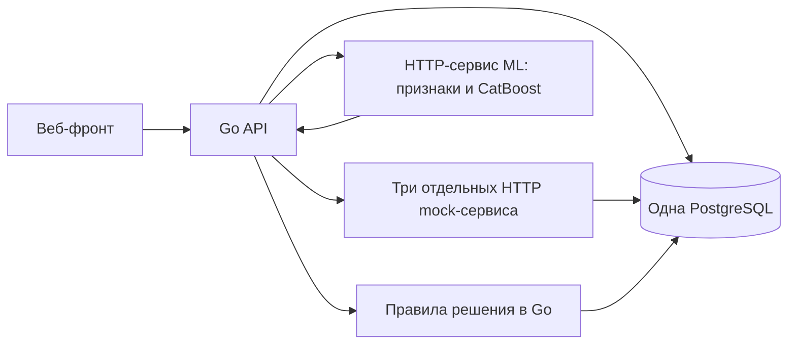

# Твой план разработки бэкенда: от нуля до демонстрации

Актуальность: 25 октября 2026 года. Прочитаны все четыре локальных материала: «Альфа_1.pdf» (5 страниц), «Альфа_2.pdf» (8), «Альфа_3.pdf» (5), «Альфа_4.pdf» (8), всего 26 страниц. По твоему сообщению бэкенд ещё не начат. Дедлайн из прежней переписки — 26 октября, 18:00 МСК; план исходит из того, что он не изменился.

Навигация: Альфа_1 — исследование и границы MVP; Альфа_2 — подробная спецификация, статусы, балльный скоринг, 12 сценариев; Альфа_3 — новая спецификация Decision Engine с PD, формулой ставки и ручными триггерами; Альфа_4 — словарь данных V1.1. В вопросах ставки и определения класса используем явные изменения из Альфа_3, а не старую таблицу Альфа_2. Словарь Альфа_4 уточняет хранение, но не отменяет уже заданные в Альфа_3 числовые правила.

**Ближайшая цель:** самому написать один работающий путь `ИНН → данные компании → заявка → проверки → модель → решение → PostgreSQL → ответ фронту`, затем добавить второй продукт и действия сотрудника. Изучение привязываем к этому пути, а не к прохождению полного курса Go.

Полный прежний объём с обучением с нуля в оставшееся время не помещается надёжно. Ниже — порядок работы, проверки после каждого шага и правила сокращения объёма. Оценки — ориентиры чистой работы; ошибки настройки и интеграции потребуют резерва. Не планируй работу без сна как способ уложиться.

## 1. Что изменилось и где заканчивается твоя ответственность

| Область | Договорённость из V1.1 | Что нужно сделать тебе |
|---|---|---|
| Хранение | Одна PostgreSQL, связанные таблицы | Схема, миграции, загрузка демо-данных, SQL-запросы |
| Внешние источники | Mock API читает сохранённые профили | Стабильные ответы по ИНН, никаких новых случайных компаний на запрос |
| Демонстрация | 12 фиксированных компаний | Импортировать согласованный набор и проверить сценарии |
| ML | CatBoost возвращает PD — вероятность дефолта | Вызвать inference, проверить ответ и сохранить результат |
| Решение | Класс, лимит, ставка, статус определяются отдельно | Реализовать конкретные правила Альфа_2 и изменения Альфа_3 в Go |
| Резерв | При недоступной модели используется балльный скоринг | Реализовать points-режим; автоматический fallback сопровождается MR05 |
| Финансы | Подтверждённая выручка отличается от заявленной | Разные поля и явное правило выбора источника |
| Время | Используются сведения, известные на дату подачи | Выбирать допустимые срезы и сохранять входной снимок |

Ты не обязан обучать CatBoost, писать генератор большой обучающей выборки или разбирать внутреннее устройство модели до интеграции. Тебе нужно понимать смысл признаков, PD, форматы и ошибки.

Предлагаемое распределение с командой: ML готовит данные и модель; один из ML-инженеров предоставляет HTTP-сервис inference и общий расчёт признаков; ты пишешь Go API, хранение, проверки, решение и интеграцию. Фронтендер работает по согласованным JSON-примерам, пока ручки ещё готовятся. Это распределение необходимо подтвердить с командой.

## 2. Первые 20–30 минут: зафиксировать уже известный контракт

Заново спрашивать пороги, ставки, стоп-факторы и статусы не нужно: они есть в материалах. Выпиши их в `docs/contract-decisions.md`, а числовые параметры — в один версионируемый конфиг. Точные значения приведены в шагах 7–8 ниже.

Сейчас достаточно получить от ML технический пример **действующего** `/predict`: адрес, вход, выход, версии и необходимые признаки. Пример входа Decision Engine в Альфа_3 — внутренний контракт функции Go, а не автоматически HTTP-контракт Python-сервиса. Не подменяй одно другим.

Принятые в этом плане варианты интеграции (это предложения реализации там, где документы оставляют выбор):

- API принимает `annual_revenue`, БД хранит его как `declared_annual_revenue`; подтверждённая выручка отдельна. Выбор выручки для модели фиксируется с ML, не меняется произвольно.
- Сбор исходных снимков выполняет Go; признаки модели желательно рассчитывать общим с обучением Python-кодом у ML. Расчёты Go для points и лимитов проверять на общих примерах.
- Моки ЕГРЮЛ, ПБ и БКИ — три отдельных сервиса, как прямо указано в Альфа_2, но одна PostgreSQL, как указано в Альфа_4. Можно использовать один небольшой Go-бинарник в трёх контейнерах с разным режимом источника; данные и реализации не дублировать.
- Финансовые поля [Н] из Альфа_4 включать по фактическому входу модели. Отдельный HTTP-сервис финансов необязателен; нельзя исключать признак, на котором модель уже обучена.
- Без согласия БКИ не вызывается; рабочий вариант до уточнения оставленной в Альфа_4 развилки — `NEED_INFO` с запросом согласия. Это не стоп-фактор и не техническая ошибка провайдера.
- Для 12 условных ИНН использовать явный демо-режим и проверку длины/цифр; контрольные суммы не должны блокировать согласованный набор. Неизвестный ИНН не создаёт случайную компанию.

Оставшиеся неоднозначности не блокируют сервер и БД. Они перечислены в конце плана с безопасными для демонстрации вариантами, отдельно от правил команды.

## 3. Минимальная архитектура



Целевая сборка: Go API, три отдельных mock-сервиса, Python-сервис ML, одна PostgreSQL и фронт. У каждого mock-сервиса собственный адрес/порт и ограниченная задача; профили лежат в общей БД. Если команда уже подготовила моки, подключай их. В учебном первом проходе допустим локальный адаптер, но финальный план включает HTTP-интеграцию с тремя сервисами.

Финансы читаем из внутренней таблицы, если этот источник согласован. Дополнительный сетевой Mock Bank Financials не обязателен. Исторические обучающие данные не должны попадать в клиентские ответы и запросы inference.

Не добавляй очередь, Redis, микросервисы для каждого источника или собственный универсальный ORM. Для первого пути достаточно последовательных вызовов с тайм-аутами и сохранённым состоянием. Если inference не укладывается в разумное время HTTP-запроса, обсудите упрощение с ML; не запускай незаписанную в БД фоновую goroutine как единственное продолжение процесса.

## 4. Как работать на каждом шаге

Цикл на 45–75 минут: **10–15 минут разобраться → 30–45 минут написать самому → 10–15 минут проверить и объяснить**. Сложный этап займёт несколько таких циклов.

Перед функцией запиши: что она получает, что возвращает, что меняет и какие ошибки возможны. Помощника проси сначала о понятии, затем о ревью своего кода. Заготовки ниже — задания, а не готовая реализация.

### Шаг 1. Запрос и JSON — 1–1,5 часа

**Разобраться:** модуль Go, struct и JSON-теги, функции, `(value, error)`, указатели на простом примере, `net/http`, `encoding/json`. Не нужно изучать goroutine и каналы до первого сервера.

**Написать:** инициализацию модуля, `GET /health` и `POST /applications`, который пока только читает и проверяет вход. Сохранение подключишь на шаге 3.

Форма из обновлённого файла: ИНН, `product`, `amount`, `term_months`, `purpose`, годовая заявленная выручка, `bki_consent`. Для оборудования — `equipment_cost` и ссылка на документ поставщика. Статус, владелец, ID и время подачи назначаются сервером.

Договорённость V1.1: суммы в API — **рубли**, не копейки. Для MVP удобно `int64` целых рублей; доли и признаки модели могут быть дробными. ИНН и ОКВЭД — строки. Для nullable-значений отличать отсутствие от нуля: например, указатель в DTO и nullable-тип при чтении SQL. Для `bki_consent` также отличать «поле не передано» от явного `false`.

**Проверить:** нормальный JSON, сломанный JSON, неизвестный продукт, пропущенное обязательное поле, отрицательная сумма. Поля черновика могут быть неполными; полная продуктовая проверка нужна при подаче.

**Объяснить без подсказки:** чем структура Go отличается от JSON; где появляется ошибка; кто пишет HTTP-ответ. Пока этого нет, не добавляй базу.

### Шаг 2. База и первая компания — 1,5–2,5 часа

**Разобраться:** таблица, строка, PK, FK, UNIQUE, NULL, SQL-параметры; миграция и seed. В Go — подключение драйвера, пул соединений, `context`, чтение строки и отличие отсутствия записи от ошибки БД.

**Написать:** запуск PostgreSQL через Compose, первую SQL-миграцию, импорт согласованных данных и функцию поиска компании по ИНН. Для HTTP — `GET /companies/{inn}`.

Базовые таблицы из словаря:

| Таблица | Минимальный смысл |
|---|---|
| companies | `company_id`, уникальный `inn`, название, форма, регистрационные сведения |
| bki_profiles | Собственный PK, `company_id` FK, `bki_as_of_date`, рейтинг, долг, платежи, просрочки |
| financial_profiles | Собственный PK, `company_id` FK, `financial_as_of_date`, финансовые агрегаты — если нужны модели |
| business_checks | Собственный PK, `company_id` FK, `check_as_of_date`, признаки проверок |
| applications | Собственный PK, владелец, `company_id` FK, вход анкеты, статус, время, версия записи |

Для быстрого MVP можно оставить один актуальный профиль на компанию с UNIQUE по `company_id` и фиксированной датой. Но и этот профиль должен быть доступен на дату подачи. Если нужны несколько срезов, уникальность — по компании и дате среза.

**Проверить:** известный ИНН возвращает компанию, неизвестный — 404, дубль ИНН запрещён БД, профиль несуществующей компании запрещён FK. Выполнить один SELECT вручную и затем тот же запрос из Go. Не вставлять пользовательские значения в SQL конкатенацией строк.

### Шаг 3. Создать и прочитать сохранённую заявку — 1–2 часа

**Разобраться:** DTO запроса и внутренняя сущность, INSERT/SELECT, JOIN, работа с ошибками между слоями. Обработчик переводит HTTP в вызов функции, SQL находится отдельно.

**Написать:** сохранение заявки, `GET /applications/{id}` и `GET /applications`. Вход `annual_revenue` отображается в `declared_annual_revenue`; он не перезаписывает `verified_annual_revenue`. Новая анкета не меняет реестровый профиль и БКИ.

Не добавляй все слои заранее. Рабочая структура по мере роста:

```text
cmd/api/main.go          настройка и запуск
internal/httpapi/       JSON и HTTP
internal/repository/    SQL
internal/providers/     чтение профилей для mock-проверок
internal/scoring/       HTTP-клиент модели
internal/decision/      чистые функции правил
internal/application/   сценарий подачи и состояния
migrations/             SQL-схема
testdata/               12 демо-компаний
docs/                   контракт, сценарии, схемы
```

**Проверить:** создать две заявки одной компании, получить разные ID, перезапустить Go и снова прочитать обе. Фронтендер уже может подключить форму и карточку.

### Шаг 4. HTTP-моки, проверки и разрешения — 2–3 часа

**Разобраться:** маленькие функции и интерфейсы по необходимости; различие ошибки источника и отрицательного бизнес-результата; аутентификация и проверка владельца.

**Написать:** три маленьких mock-сервиса, читающих свои профили из общей БД, и Go-клиент к ним. Один раз разобраться с HTTP-клиентом, затем повторить паттерн для остальных источников. До обращения к БКИ проверять сохранённое согласие в сценарии заявки. Не отдавать БКИ через публичный mock-маршрут в обход этого ограничения: такие маршруты внутренние или защищённые.

Для тайм-аута/временного 5xx — до трёх попыток суммарно, с ограничением времени и небольшой задержкой. Не повторять 404, ошибки валидации или отсутствие согласия. После трёх неудач — MR04, в журнале источник и число попыток. Без обязательных данных не считать фиктивный нулевой долг и не одобрять заявку; подробнее в разделе неоднозначностей.

При подаче валидировать ограничения из V1.1:

- `EXPRESS`: 300 000–5 000 000 ₽, 6–36 месяцев.
- `EQUIPMENT`: 500 000–15 000 000 ₽, 12–60 месяцев; сведения об оборудовании и нужный документ.
- Суммы и сроки вне диапазона — ошибка формы, а не отказ модели.
- Не хватает нужных сведений — `NEED_INFO` или другая согласованная ветка; `null` не заменять нулём.

Добавить простую тестовую сессию с ролью и владельцем, назначаемыми сервером. Фронт не определяет свои права полями `user_id` или `role`. Проверять доступ к карточке, списку, истории и файлам. Не нужно писать полноценную регистрацию и восстановление пароля для демо.

**Проверить:** согласия нет — вызов БКИ не состоялся; чужая заявка недоступна; одинаковый ИНН возвращает одинаковые данные; после третьего временного сбоя возникает MR04, 404 не повторяется.

### Шаг 5. Снимки и признаки — 1–1,5 часа при готовом ML-контракте

**Разобраться:** исходные данные и производные признаки; почему нужны даты; что такое утечка будущего в предсказание.

**Написать:** сбор входа модели на момент серверного `submitted_at`. Для исторических срезов выбирается последний допустимый: дата среза не позже подачи. Для date-полей согласовать временную зону и смысл доступности: дата отчётного периода сама по себе не доказывает, что отчёт уже был известен. Для демо зафиксировать допущение или хранить отдельное `available_at`.

Сохранять входной JSON-снимок, ссылки на использованные профили, момент расчёта и версии контракта/признаков. Это отличается от простого чтения «последней строки» при открытии карточки.

Если расчёт признаков находится у ML, тебе нужно проверить смысл, а не дублировать реализацию:

| Признак | Что понимать |
|---|---|
| business_age_months | Полные месяцы от регистрации до подачи, а не до сегодняшнего дня |
| monthly_revenue | Выбранная годовая выручка / 12; источник сохраняется явно |
| new_payment_at_reference_rate | Платёж при предварительной демонстрационной ставке, в документе указано 25% годовых |
| payment_to_revenue | Существующий плюс новый месячный платёж / месячная выручка |
| loan_amount_to_revenue | Запрошенная сумма / годовая выручка |
| projected_dscr | Доступный месячный поток / все месячные платежи; только при наличии нужного источника |

Нулевая выручка, неизвестная выручка и отсутствие финансового профиля — разные случаи. Не допускать деления на ноль, NaN/Infinity и подстановки случайных значений. Правило выбора между подтверждённой и заявленной выручкой должно совпадать с обучением.

**Проверить:** будущий профиль исключён; исходный профиль изменили — сохранённый вход старого рассмотрения не изменился. В запросе модели отсутствуют `default_12m`, `latent_default_probability`, `generator_scenario` и результаты будущего исполнения кредита.

### Шаг 6. Вызов модели — 1,5–2 часа

**Разобраться:** Go как HTTP-клиент, тайм-аут и context, статус ответа, чтение и закрытие тела, JSON-декодирование. PD `0.08` означает 8%, а не 0.08% и не score 8.

**Написать:** один клиент `/predict` по реальному контракту команды. Адрес берётся из конфигурации. Пример желаемого ответа для согласования: `pd`, `model_version`, `feature_schema_version`; названия не навязываются уже работающему сервису.

Проверять HTTP-статус, наличие PD, конечное число в `[0,1]`, нужные версии; ограничить ожидание и размер ответа. `pd=0` допустимо, отсутствие `pd` — нет. Ответ модели по Альфа_3 содержит `pd`, `model_version`, `top_factors` с `feature` и `contribution`. Согласовать с ML смысл и шкалу SHAP-вкладов: их нельзя автоматически называть изменением вероятности в процентных пунктах. Для выбора причин важно, что положительный вклад соответствует повышению риска.

`scoring_mode=model` использует модель, `scoring_mode=points` явно выбирает баллы. При недоступности модели Альфа_3 предписывает балльный fallback и MR05. Это разрешённая спецификацией ветка, не скрытая заглушка: сохранять исходный режим, фактический режим, причину fallback и факт, что использована условная PD класса, а не предсказание CatBoost. Для повреждённого ответа также не выдавать одобрение; вариант реализации — тот же fallback с явной технической причиной.

**Проверить:** успех, тайм-аут, HTTP 500, повреждённый JSON, пропущенная PD, значение вне диапазона; при автоматическом переходе на points возникает MR05 и заявка требует человека. Принудительный points-режим сам по себе не означает недоступность модели: не подделывать этот факт в аудите.

### Шаг 7. Решение, лимит и условия — 3–4 часа

**Разобраться:** чистая функция, таблица правил, границы диапазонов, округление, различие предварительной и итоговой ставки.

**Написать:** Decision Engine как функцию с явным входом и выходом. Она не ходит в HTTP и БД — это позволит проверять правила отдельно.

Не пиши весь Decision Engine сразу. Последовательно реализуй и проверь маленькие функции: стоп-факторы, points, класс по PD, ставка, платёж, лимит, матрица, ручные триггеры, причины. Их соединяет сценарий подачи; стоп-факторы проверяются **до** HTTP-вызова модели.

**7.1. Стоп-факторы — точные правила Альфа_2:**

| Код | Условие |
|---|---|
| SF01 | Регистрационный `status=LIQUIDATING` |
| SF02 | Регистрационный `status=BANKRUPT` или `bki.bankruptcy=true` |
| SF03 | Возраст бизнеса меньше 3 полных месяцев |
| SF04 | Текущая просрочка строго больше 30 дней |
| SF05 | Дисквалифицированный руководитель |
| SF06 | ОКВЭД `92.*`, `11.01–11.05`, `12.*` |

Любой стоп-фактор → REJECTED, модель не вызывается, сотруднику в очередь ручной проверки заявка не попадает. Не путать текущую просрочку SF04 с погашенной просрочкой за год. Правила префиксов/подклассов ОКВЭД реализовать через явное нормализованное сопоставление, не сравнением float.

**7.2. Сначала points-режим для отладки всего пути:**

| Фактор | Баллы |
|---|---|
| F1, полные месяцы | <6: 0; 6–11: 5; 12–23: 10; 24–59: 15; ≥60: 20 |
| F2, payment_to_revenue | ≤0.20: 25; ≤0.35: 15; ≤0.50: 5; >0.50: 0 |
| F3, max_overdue_days_12m | 0: 20; 1–30: 10; >30: 0 |
| F4, rating | ≥750: 15; 650–749: 10; 500–649: 5; <500: 0 |
| F5, amount/annual_revenue | ≤0.15: 10; ≤0.30: 5; >0.30: 0 |
| F6, отрасль | Повышенный риск `41`, `42`, `43`, `47.25`, `56`: 0; обычная: 10 |
| P1/P2/P3 | По −10: массовый адрес; долг приставам >1 000 ₽; нет отчётности >12 месяцев |

Итог снизу ограничить нулём. Points-классы: A 75–100, B 60–74, C 45–59, D 30–44, E 0–29. Сохранять вклад каждого фактора, а не только сумму. В расчёте F2 новый платёж вычисляется при **25% годовых**, как в Альфа_2. Для класса E условная PD не задана и для отказа/рекомендации отказа не нужна: не выдумывать её.

**7.3. Основной режим модели:**

| Класс | Интервал PD | Условная PD только для points-режима |
|---|---|---|
| A | `[0, 0.04)` | 0.02 |
| B | `[0.04, 0.08)` | 0.06 |
| C | `[0.08, 0.15)` | 0.115 |
| D | `[0.15, 0.25)` | 0.20 |
| E | `[0.25, 1]` | Не определена |

Стартовые пороги берутся из Альфа_3 и хранятся в конфиге. Менять их после обучения — отдельное версионируемое решение команды, не автоматическая подгонка на запросе.

**7.4. Ставка и лимит:**

- В долях: `annual_rate = base_rate + pd * lgd`, округлить до ближайших 0.005 и ограничить сверху 0.30. EXPRESS: база 0.16, LGD 0.6; EQUIPMENT: база 0.14, LGD 0.4. На границе округления используем явное правило, например половину вверх для неотрицательных ставок.
- Примеры команды для PD 0.02/0.06/0.10/0.20: EXPRESS 17/19.5/22/28%; EQUIPMENT 15/16.5/18/22%. Это готовые контрольные случаи.
- Аннуитет: `payment = principal * r / (1 - (1+r)^(-n))`, `r=annual_rate/12`; при r=0 отдельно `principal/n`.
- Допустимый новый платёж: `0.5 * monthly_revenue - existing_monthly_payment_rub`. Если он ≤0, доступная сумма по платежу равна 0.
- Лимит по платежу: допустимый платёж, разделённый на аннуитетный коэффициент при **итоговой**, а не предварительной ставке.
- EXPRESS: минимум 5 млн, `0.4 * annual_revenue`, лимита по платежу.
- EQUIPMENT: минимум 15 млн, `1.0 * annual_revenue`, лимита по платежу и `0.9 * equipment_cost`.
- Итоговый лимит округлить вниз до 10 000 ₽; сохранить ограничивающий фактор PRODUCT/REVENUE/DTI/COLLATERAL и исходные лимиты.

Проценты в вычислениях — доли. Пример API Decision Engine в Альфа_3 возвращает `offer.rate=18.0` в процентах: преобразовать ровно на границе DTO и явно описать единицу. Не смешивать 0.18 и 18 внутри формул.

**7.5. Матрица:**

| Класс | EXPRESS | EQUIPMENT: рекомендация |
|---|---|---|
| A/B | amount ≤ limit: APPROVED; иначе COUNTER_OFFER на limit | Аналогично |
| C | COUNTER_OFFER на `min(0.7*amount, limit)` | Аналогично |
| D | MANUAL_REVIEW: контрпредложение `min(0.5*amount, limit)` или отказ | Отказ |
| E | REJECTED | Отказ |

Сумма предложения ниже минимума продукта → отказ; срок остаётся запрошенным. Для D EXPRESS рабочая трактовка: если половина суммы в пределах лимита и не ниже минимума — рекомендовать контрпредложение, иначе отказ. Дополнительный вариант с более длинным сроком в Альфа_3 отмечен Should: оставить после основного пути.

**7.6. После матрицы — все ручные триггеры Альфа_3:**

| Код | Когда применяется |
|---|---|
| MR01 | EQUIPMENT |
| MR02 | Класс D |
| MR03 | Сумма предложения строго >3 000 000 ₽, не просто запрошенная сумма |
| MR04 | Mock-источник не ответил за 3 попытки |
| MR05 | Модель недоступна, использован балльный fallback |

Триггер переводит заявку в MANUAL_REVIEW, исходный результат матрицы сохраняется как recommendation. Стоп-факторы имеют приоритет над всеми MR. По буквальной последовательности Альфа_3 EQUIPMENT с классом E также идёт сотруднику с рекомендацией отказа, если нет стоп-фактора. Не скрывать рекомендацию отказа за фиктивным предложением.

**7.7. Причины:**

- Стоп-фактор: SF01–SF06.
- Ограничивающий лимит: R05 по выручке, R02 по нагрузке, R11 по залогу. Для PRODUCT специальный код в документах не задан; сохранить binding, не приписывать ему R05.
- В режиме model для C/D/E: положительные вклады риска из `top_factors`, сортировка по убыванию, перевод в коды, удаление повторных кодов, первые три. Сервис ML должен вернуть достаточно факторов для этой процедуры.
- В режиме points: потери баллов относительно максимума; положительные потери сортируются по убыванию, при равенстве F1…F6, P1…P3; первые три.
- Справочник: возраст→R01; нагрузка/текущие платежи→R02; прошлая просрочка→R03; рейтинг→R04; сумма/отношение к выручке→R05; отрасль→R06; массовый адрес→R07; приставы→R08; отчётность→R09; низкая выручка→R10; залог→R11. M01 — ручное решение, N01 — документ поставщика, N02 — подтверждение выручки.

В Альфа_3 для причин используются `age_months`, `dti`, `amount_ratio`, `bailiff_debt_rub`; в Альфа_4 — `business_age_months`, `payment_to_revenue`, `loan_amount_to_revenue`, `enforcement_debt_rub`. Сделать явное отображение имён в адаптере контракта, не создавать независимые поля с разными значениями. Незнакомый признак не превращать в выдуманную причину.

**Проверить:** границы PD 0.04/0.08/0.15/0.25, шесть SF без вызова модели, ставку на четырёх примерах, лимит и его округление, минимум контрпредложения, каждый MR, fallback, отсутствие положительных SHAP-причин. Сохранять `policy_version`, режим и версию модели вместе с решением.

### Шаг 8. Состояния, история, сотрудник — 2–3 часа

**Разобраться:** конечный автомат — только разрешённые действия; транзакция; конфликт двух запросов; повторная отправка.

Статусы из Альфа_2 (сохраняем именно эти имена):

```text
DRAFT → SUBMITTED → DATA_CHECK → SCORING
DATA_CHECK → NEED_INFO → DATA_CHECK
SCORING → APPROVED | COUNTER_OFFER | MANUAL_REVIEW | REJECTED
MANUAL_REVIEW → APPROVED | COUNTER_OFFER | REJECTED | NEED_INFO
APPROVED → SIGNING
COUNTER_OFFER → SIGNING | CLOSED
SIGNING → ISSUED
```

Отзыв клиентом до завершения рассмотрения переводит заявку в CLOSED: явный набор допустимых исходных состояний зафиксировать по строке «DRAFT … MANUAL_REVIEW» из таблицы. Не разрешать изменение выданной заявки. Принятие обычных условий и контрпредложения ведёт сразу в SIGNING; подтверждение подписи — в ISSUED. Отдельная публичная команда «выдать деньги» для этого сценария не нужна.

Доработка возвращает в DATA_CHECK, а не в SUBMITTED. Стоп-факторы вычислить до модели, результат отказа зарегистрировать из SCORING, как задано в таблице. MR04 — расширение из Альфа_3 для сбоя на этапе DATA_CHECK; переход и его приоритет отдельно описаны ниже, чтобы не добавить скрытый произвольный переход.

После доработки создаётся новая попытка рассмотрения со снимком; история предыдущей остаётся. Альфа_4 задаёт отсечение по submitted_at. Вариант для MVP: submitted_at первой подачи не менять, а новую попытку считать на том же отсечении; если нужны новые внешние сведения, отдельно согласовать версионируемый момент отсечения. Не заменять submitted_at текущим временем незаметно для воспроизводимости. Повтор того же запроса без изменений не создаёт второе решение.

Правила сотрудника по Альфа_3: APPROVED, COUNTER_OFFER, REJECTED или NEED_INFO; комментарий обязателен всегда, код причины обязателен при отказе. Новая сумма не выше limit — проверяет сервер, не только интерфейс. Если результат отличается от рекомендации, сохраняется `override=true`; изменение предложенных условий также отражать в аудите. Сотрудник не может отменить стоп-фактор через ручной маршрут.

Дополнительное хранение: события заявки, попытки рассмотрения со снимками/результатом ML, решения, метаданные документов. Можно хранить подробности снимков в JSONB, не создавая таблицу на каждый признак.

Действие изменения статуса + событие + решение сохранять атомарно. Не держать транзакцию и блокировку строки открытыми во время HTTP-вызова модели: сначала коротко зафиксировать начало попытки, вызвать сервис, затем сохранить результат с проверкой версии/текущей попытки. Зависшая после перезапуска попытка должна быть видна и иметь контролируемый путь повтора.

**Проверить:** клиент не решает за сотрудника; сотрудник не подписывает за клиента; два submit не создают два решения; оборудование проходит ручной этап; прошлые результаты не перезаписываются новой попыткой.

### Шаг 9. Docker и демо — 1,5–2 часа плюс резерв

**Разобраться:** контейнер, порт, переменная окружения, volume, healthcheck, имя сервиса внутри Compose. `localhost` в Go-контейнере не указывает на контейнер модели.

**Написать:** Dockerfile Go, Compose с API, тремя mock-сервисами, моделью, PostgreSQL и фронтом; `.env.example`, миграции/seed с повторяемым запуском, краткий README. Один Go-образ допускается запускать в разных ролях для трёх mocks. Пароли и реальные секреты в репозиторий не добавлять. Версии зависимостей и весов зафиксировать.

**Проверить:** запуск по инструкции другим участником; данные переживают обычный перезапуск; модель доступна; 12 компаний загружаются без дублей; заявка проходит через веб-фронт до результата.

## 5. Минимальный API: согласовать, затем реализовывать по очереди

Названия путей — предложение. Существующий контракт фронта важнее косметического переименования.

| Очерёдность | Метод и путь | Для чего |
|---|---|---|
| 1 | GET /health | Проверить запуск |
| 2 | GET /companies/{inn} | Автозаполнение регистрационных данных |
| 3 | POST /applications | Сохранить черновик |
| 4 | GET /applications/{id} | Карточка, статус, результат, следующий шаг |
| 5 | GET /applications | Собственные заявки или очередь сотрудника по роли |
| 6 | POST /applications/{id}/submit | Проверки, скоринг, решение |
| 7 | PATCH /applications/{id} | Исправить допустимые поля до подачи/при доработке |
| 8 | GET /applications/{id}/history | История |
| 9 | POST /applications/{id}/decision | Решение сотрудника/запрос сведений |
| 10 | POST /applications/{id}/accept-offer и /decline-offer | Принять условия → SIGNING или отклонить контрпредложение → CLOSED |
| 11 | POST /applications/{id}/sign | Подтвердить условную подпись → ISSUED |
| 12 | POST /applications/{id}/withdraw | Отозвать из разрешённых незавершённых состояний |

Тестовый вход и минимальную загрузку документа включить при подключении кабинетов. Для EQUIPMENT согласовать реальную загрузку синтетического файла или явно обозначенную симуляцию с seed-документом. Ссылка `supplier_document_id` должна указывать на существующий разрешённый документ; путь к произвольному файлу сервера не принимается. Пользователь видит, какая часть смоделирована.

Единый формат ошибок: `code`, `message`, при необходимости `field_errors` и `request_id`. Из документа: неизвестный ИНН — 404, неправильные поля — согласованный код валидации, например 422. Дополнительно: неправильный JSON — 400, доступ — 401/403, конфликт состояния — 409. Недоступная БД/модель и бизнес-отказ имеют разные ответы и состояние.

## 6. Расписание от текущего момента

Не привязываемся к неизвестному часу начала. Выполняй блоки по готовности и оставь последние 3–4 доступных часа до сдачи на проверку и упаковку. Сумма оценок полного пути — примерно 15–22 часа чистой работы; для новичка может потребоваться существенно больше. Это оценка объёма, а не обещание уложиться одному.

| Блок | Результат | Что можно отдать команде |
|---|---|---|
| Первый рабочий блок | Контракт, сервер, БД, компания, сохранённая заявка — шаги 1–3 | Данные и сервис модели готовят ML; фронт использует JSON-примеры |
| Второй рабочий блок | Проверки, snapshots и первое решение в points — шаги 4–5 и 7; затем реальная модель — шаг 6 | Помощь с Compose/README, подготовка ручных сценариев |
| Третий рабочий блок | Роли, оборудование, сотрудник, история, завершение — шаг 8 | Фронт подключает кабинеты и проводит совместный прогон |
| Финальный блок | Воспроизводимый запуск, тесты, документы, фиксация сдачи — шаг 9 | Общая проверка на машине другого участника |

**Контроль риска:** если за первые 4–6 часов нет заявки в БД, попроси команду взять настройку окружения и упаковку, а сам сосредоточься на API. Если после следующего блока нет пути до решения, сокращайте интерфейс и дополнительные функции; не добавляйте новые модули. Отметьте честно, какие обязательные части ещё не реализованы.

Первый рабочий points-путь — полноценный предусмотренный командой режим для интеграции, затем подключается CatBoost. Он не заменяет проверку настоящей модели перед сдачей, если вы заявляете модель частью решения. Сначала научись получать и сохранять корректный результат, потом расширяй обработку ошибок и ручные действия.

До сдачи убираем из личного плана: LLM-чат, OCR, полный транзакционный поток, обучение модели своими руками, сложные фоновые задачи, второй вариант с удлинённым сроком (Should), настоящее БКИ/ФНС, облачное развёртывание до локального прогона. Два продукта, хранение и связный путь остаются целью; при нехватке времени команда должна принять явное решение о сокращении, а не маскировать незавершённые экраны.

К 26 октября, 15:00 МСК желательно прекратить добавление функций; до 16:00 зафиксировать проверенный commit/tag и материалы, оставив запас до 18:00. Это целевой резерв, не дополнительный срок разработки.

## 7. Короткие проверки, которые действительно нужны

1. Известный/неизвестный ИНН; сохранение заявки после перезапуска.
2. Входные суммы в рублях; `null`, ноль и отсутствие поля не смешаны.
3. Без согласия БКИ не вызывается; чужие заявки и документы недоступны.
4. Будущие данные не участвуют, а входной снимок сохраняется.
5. Модель: успех, тайм-аут, 500, неправильный JSON, пропущенная/некорректная PD; переход в points с MR05 и без выдуманной model_version.
6. Правила: все SF, границы A–E, контрпредложение, все MR, одинаковая PD с разными ставками двух продуктов, итоговый платёж.
7. Состояния: запрещённый переход, двойная подача, доработка с новой попыткой.
8. Полный запуск через Compose и сценарий через фронт на другой машине.

В Go автоматизируй прежде всего чистые правила и обработку ошибок клиента модели. SQL проверяй на тестовой БД; браузерный путь проходите вместе с фронтендером. После исправления проверяй связанный сценарий, не трать время на формальный процент покрытия.

### Контрольные 12 компаний из Альфа_2

Возраст привязать к зафиксированной дате демонстрации, а не высчитывать каждый раз от сегодняшнего дня. Согласованные ИНН — `7700000001` … `7700000012`; полного набора всех полей в сценарной таблице нет, недостающие значения генератор должен заполнить согласованно.

| № | Ожидаемый points-результат | Что проверяет |
|---|---|---|
| 1 | 95/A, APPROVED | Обычное экспресс-одобрение |
| 2 | 70/B, APPROVED | Умеренные риски |
| 3 | 70/B, COUNTER_OFFER 2.4 млн → CLOSED | Лимит по выручке и отказ клиента |
| 4 | 45/C, COUNTER_OFFER 700 тыс. | Матрица класса C |
| 5 | 30/D, MANUAL_REVIEW | Ручной EXPRESS |
| 6 | 0/E, REJECTED; R02, R01, R03 | Причины points по потере баллов |
| 7 | REJECTED SF01 | Ликвидация |
| 8 | REJECTED SF04 | Текущая просрочка 45 дней |
| 9 | REJECTED SF03 | Возраст 2 месяца |
| 10 | REJECTED SF05 | Дисквалификация |
| 11 | NEED_INFO N01 → 95/A → MANUAL_REVIEW → SIGNING → ISSUED | Документ поставщика, ручное одобрение, принятие и подпись |
| 12 | 45/C → MANUAL_REVIEW, рекомендация 5.6 млн | EQUIPMENT и контрпредложение |

Для №11 между MANUAL_REVIEW и SIGNING сотрудник переводит заявку в APPROVED, затем клиент принимает условия. №12 также превышает 3 млн предложения и должен фиксировать MR03 наряду с MR01. Дополнительно к 12 компаниям нужны проверки SF02/SF06 и MR04/MR05 — основной набор их не покрывает.

Числа score из таблицы проверяют **балльную функцию**. В model-режиме проверяется PD-класс и новый Decision Engine, а не равенство выдуманного score и PD. Альфа_3 требует проверить демо-классы у ML; если они не совпали, меняют синтетические исходные профили с последующим пересчётом ожидаемых данных. Никогда не подменять ответ модели по ИНН ради нужного экрана. Если набор изменили для model-демо, старые points-ожидания нельзя считать автоматически верными: версионировать оба набора/ожидания.

## 8. Обязательные материалы к сдаче

По ранее разобранному исходному кейсу: README с запуском/окружением/сценарием, OpenAPI, коллекция запросов, архитектурная схема, диаграмма состояний, модель данных, тестовые сценарии и учётные записи, THIRD_PARTY_NOTICES с компонентами/моделью/датасетами/симуляциями, фиксированная версия репозитория. Разделите оформление с командой; учебный план не заменяет эти материалы.

Дополнительно для V1.1 сохранить версии схемы признаков, модели и правил, seed/версию демо-данных и список нерешённых допущений. Метрики на синтетике не выдавать за подтверждение качества реального банковского скоринга.

## 9. Как будем использовать помощь при написании кода

Рабочая просьба к помощнику: «Объясни одну нужную концепцию, дай маленькое задание, не пиши реализацию. После моей попытки проверь код и сначала дай подсказки».

На ревью приноси: задачу, свой код, ожидаемый результат, фактический ответ/ошибку и то, что уже проверил. Если застрял на 20–30 минут без новой гипотезы, проси объяснить конкретный сбой, а не сгенерировать весь сервис.

Перед переходом дальше ответь своими словами: где проверка входа; где SQL; кто назначает статус; что будет при ошибке модели; как отличить повтор от новой попытки. После дедлайна вернись к отложенному: контекст и отмена глубже, конкурентность Go, SQL-индексы и планы запросов, устойчивое фоновое выполнение и более полная авторизация.

**Первое задание сейчас:** договориться об одном примере анкеты и ответа модели; затем самостоятельно создать Go-модуль и `GET /health`. Следующая задача — разобрать JSON анкеты и вернуть ошибки валидации. Пока эти два действия не понятны, остальной проект не генерируем.

## 10. Как совместить небольшие расхождения документов

Основные бизнес-вопросы закрыты файлами; ниже не новая анкета команде, а узкие места, которые нельзя молча трактовать по-разному в Go и ML.

| Место | Что задано | Вариант реализации / что осталось уточнить |
|---|---|---|
| Ставки | Альфа_2 даёт фиксированную таблицу; Альфа_3 явно заменяет её формулой | Использовать формулу Альфа_3; 25% остаётся лишь предварительной ставкой признаков points |
| PD-классы | Альфа_4 пишет «нужно согласовать»; Альфа_3 уже задаёт стартовые границы | В конфиге 0.04/0.08/0.15/0.25 и policy_version |
| Отдельные моки и одна БД | Альфа_2: три сервиса; Альфа_4: одна PostgreSQL | Три сетевых сервиса читают связанные таблицы одной БД; это не противоречие |
| MR04 и таблица состояний | Сбой источника происходит в DATA_CHECK, новый DE требует MANUAL_REVIEW | Явно добавить документированное расширение DATA_CHECK → MANUAL_REVIEW по MR04; неполные данные отметить, числовую рекомендацию не выдумывать |
| Одобрение после MR04 | Нет данных для надёжного limit/score, но сотрудник видит заявку | Карточка с доступными снимками и ошибками; до получения обязательных сведений разрешать запрос данных/отказ, не одобрение. Это защитная трактовка для согласования, не дословное правило файла |
| Согласие | Запрет вызова БКИ однозначен; дальнейшая ветка оставлена открытой в Альфа_4 | NEED_INFO с запросом согласия; MR04 не использовать для отсутствия согласия |
| Переход после доработки | NEED_INFO → DATA_CHECK | Версионировать попытки, не вводить возврат в SUBMITTED из предыдущего плана |
| SHAP и словарь | В Альфа_3 старые короткие имена, в Альфа_4 уточнённые | Один явный mapping имён, единицы и направление вкладов; ответственность за вычисление SHAP у ML |
| Финансовый профиль | В Альфа_4 это предложение, не обязательный новый экран анкеты | Подключать по реальной схеме модели; не заставлять клиента вводить десятки агрегатов |
| Округления | Ближайшие 0.5 п.п. ставки и вниз 10 тыс. лимита | Зафиксировать половину вверх для ставки; округление платежа/ничьи binding также описать в контракте |
| Fallback и E | Даны условные PD для A–D, но не для E | Для points-E отказ/рекомендация отказа без условной PD и без ставки; при fallback MR05 сохраняется |

Номера API, раскладка пакетов, оценки времени, политика повторов внутри общего лимита и предложенные трактовки этой таблицы — технические решения плана. Стоп-факторы, продуктовые параметры, матрица, исходные состояния и MR-триггеры — извлечены из командных материалов.

Источники: «Альфа_1.pdf», стр. 1–5 (контекст); «Альфа_2.pdf», стр. 1–8 (MVP, данные, состояния, points, сценарии); «Альфа_3.pdf», стр. 1–5 (изменения Decision Engine, PD, формула ставки, MR, SHAP, контракт и конфиг); «Альфа_4.pdf», стр. 1–8 (словарь V1.1, схема БД, временные срезы и разделение обучения/inference). Все четыре файла прочитаны полностью.
