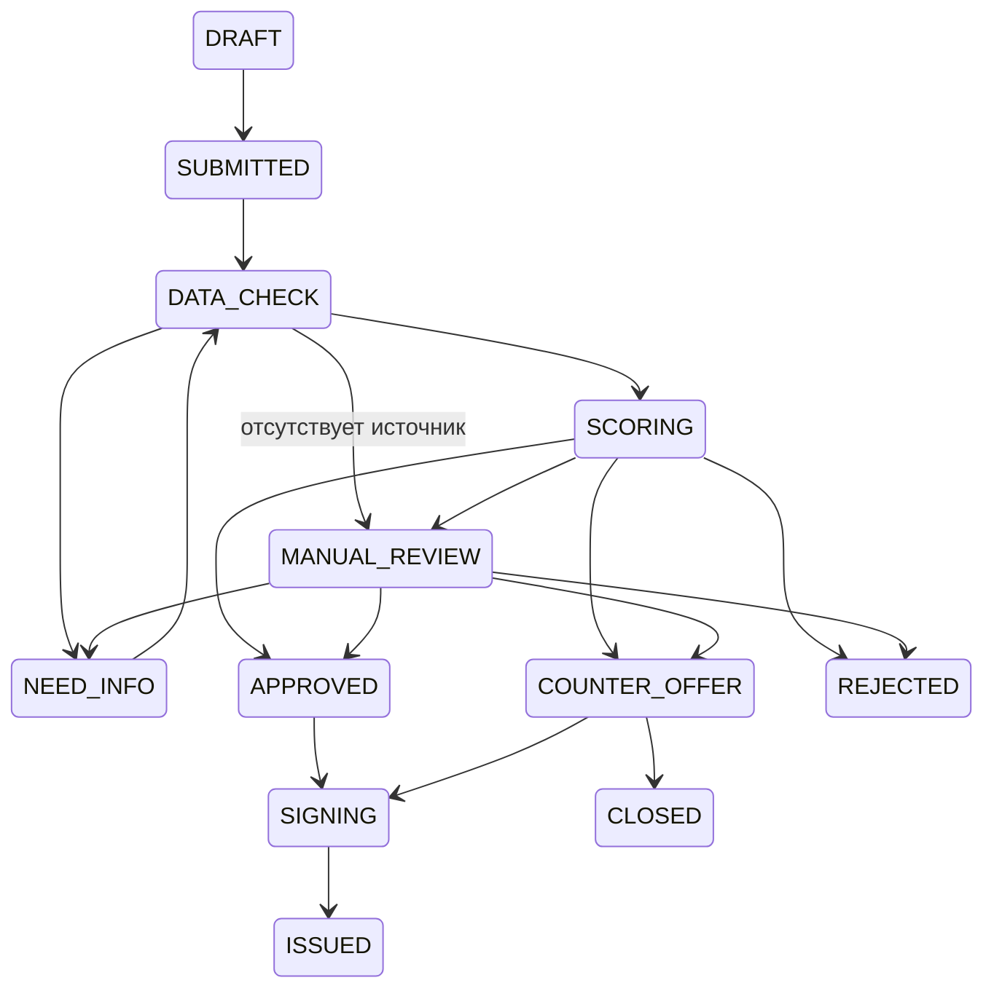
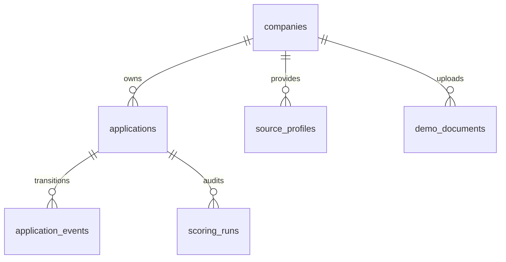

# API демонстрации

Base URL: http://localhost:8081. JSON UTF-8, деньги — рубли. Все /applications и /documents требуют HttpOnly session-cookie после тестового входа. Клиент ограничен своей компанией; сотрудник имеет очередь и право ручного решения.

| Метод | Путь | Результат |
|---|---|---|
| GET | /health | Доступность API |
| GET | /companies | Демо-компании и примеры анкет |
| GET | /companies/{inn} | Регистрационные сведения |
| POST | /demo/login | Тестовый вход: role=client/analyst, inn для клиента |
| POST | /applications | Создание DRAFT, 201 |
| GET | /applications | Собственные заявки либо очередь сотрудника |
| GET | /applications/{id} | Краткая карточка |
| GET | /applications/{id}/detail | Параметры заявки и сохранённое решение |
| POST | /applications/{id}/submit | DRAFT → SUBMITTED, повтор → 409 |
| POST | /applications/{id}/process | Проверки, модель, решение; SUBMITTED или NEED_INFO |
| GET | /applications/{id}/history | История переходов |
| POST | /documents | multipart/form-data, поле file, до 5 МБ |
| PATCH | /applications/{id} | Согласие/ссылка на свой документ в DRAFT/NEED_INFO |
| POST | /applications/{id}/decision | Ручное решение сотрудника, обязательный comment |
| POST | /applications/{id}/accept-offer | APPROVED/COUNTER_OFFER → SIGNING |
| POST | /applications/{id}/decline-offer | COUNTER_OFFER → CLOSED |
| POST | /applications/{id}/sign | SIGNING → ISSUED, симуляция |
| POST | /applications/{id}/withdraw | Отзыв из разрешённых состояний |

Примеры Git Bash:

```bash
curl.exe -c cookies.txt -H 'Content-Type: application/json' -d '{"role":"client","inn":"7700000001"}' http://localhost:8081/demo/login
curl.exe -b cookies.txt -H 'Content-Type: application/json' -d '{"inn":"7700000001","product":"EXPRESS","amount":2000000,"term_months":24,"purpose":"Working capital","annual_revenue":24000000,"bki_consent":true}' http://localhost:8081/applications
curl.exe -b cookies.txt -X POST http://localhost:8081/applications/1/submit
curl.exe -b cookies.txt -X POST http://localhost:8081/applications/1/process
curl.exe -b cookies.txt http://localhost:8081/applications/1/detail
curl.exe -b cookies.txt http://localhost:8081/applications/1/history
```

Неизвестная заявка → 404, неверный ID/JSON → 400, чужая компания → 403, конфликт состояния → 409. Технический сбой не выдаётся за бизнес-отказ. Недоступная модель — points_fallback и ручная проверка MR05. Клиенту не раскрывается внутренний текст SQL-ошибок.

Модель: POST :8000/predict — оригинальный named-features JSON из input.example.json; POST :8000/predict-sources — пять исходных снимков из source_snapshots.example.json. GET :8000/health — версия весов. Вероятность PD — доля [0,1]; сервер добавляет фактически использованные features и SHAP top_factors (raw log-odds).

## Состояния



## Модель данных



application_events хранит переход и инициатора. scoring_runs хранит исходные снимки, фактический ответ модели и принятое решение. Повторная подача не создаёт второй переход DRAFT → SUBMITTED; конкурирующие процессоры ограничены условным изменением состояния.
